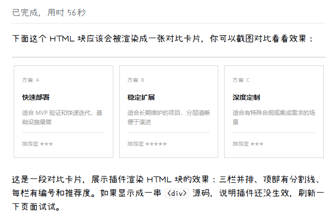

# dsh-html-view

让 DSH 助手回复里的 HTML 直接显示成画面，不再是一堆源码。

## 安装

打开 DSH → 设置 → 插件 → 添加本地目录，选中本仓库文件夹即可。

装完刷新一次页面生效，不需要重启。

## 效果

助手正文里写了 `
`、`<table>` 这类块级 HTML，装之前你看到的是一串转义标签，装之后直接看到渲染好的画面——卡片、流程图、对比矩阵，写的是什么样，看的就是什么样。

表格、公式、代码高亮、思考过程、图片，全部不受影响。

## 内置 Skill

插件自带一个 `html-visualization` Skill，教模型怎么把内容排成可视化卡片，不用你手动配提示词。

装上之后模型会自动发现并使用它，于是回复长这样：一组黑白灰的卡片、对比矩阵、流程图，穿插在正文之间。

Skill 的写作规则参考了 LINUX DO 用户 [Eeevan](https://linux.do/u/Eeevan/summary) 分享的[可视化表达提示词](https://linux.do/t/topic/3069590)，见下方[致谢](#致谢)。

如果想自己改，编辑 `index.js` 里的 `SKILL_CONTENT` 即可。

## 使用

不需要做任何事。助手写了 HTML 块就自动渲染，没写就当没装过。

- 块级标签（`div`、`section`、`table`、`svg`、`figure`、`style` 等）从行首开始即算可视化块
- 想看源码就用带 `html` 标注的代码块，它按代码显示
- 行内标签（`<b>`、``）不受干预，强调照样用 `**粗体**`

## 特性

- **不影响现有功能**：表格、KaTeX、代码高亮、思考过程、图片、流式输出、复制按钮，全部保持原样
- **高度自适应**：卡片内容多高就显示多高，不出现多余滚动条
- **主题跟随**：自动读取 DSH 的明暗主题，不用你调配色
- **流式友好**：输出未完成时按节奏刷新，不逐字闪烁
- **沙箱隔离**：脚本不执行、外部资源不加载、链接不可点、页面不可跳转
- **故障自愈**：渲染出错自动退回 DSH 默认渲染，不会白屏

## 常见问题

**装了之后没变化？**
先刷新页面（Ctrl+R）。仍无效则检查插件是否在插件页显示为已启用。

**HTML 里能放图表库（ECharts、D3）吗？**
不能。沙箱禁止脚本和外部网络，只能渲染静态 HTML + 内联样式 + `<style>` 标签。

**复制消息会复制到什么？**
原始的 Markdown 文本，包括 HTML 源码。渲染只影响你看到的画面，不改写内容。

**模型不主动写 HTML 怎么办？**
在对话里说一句「用可视化卡片展示」即可。也可以直接在系统提示词里贴上面那份 [Eeevan 的提示词](https://linux.do/t/topic/3069590)。

## 致谢

Skill 的写作规则参考 LINUX DO 用户 [Eeevan](https://linux.do/u/Eeevan/summary) 分享的[可视化表达提示词](https://linux.do/t/topic/3069590)。感谢分享。

## License

[PolyForm Noncommercial 1.0.0](LICENSE)

非商用自由使用、复制、分发、修改。任何商业目的的使用（出售、作为商业产品的一部分、为商业客户提供服务）需要单独授权。
